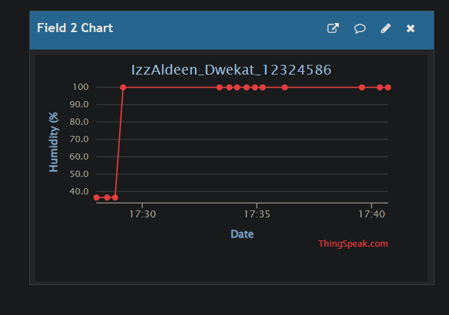
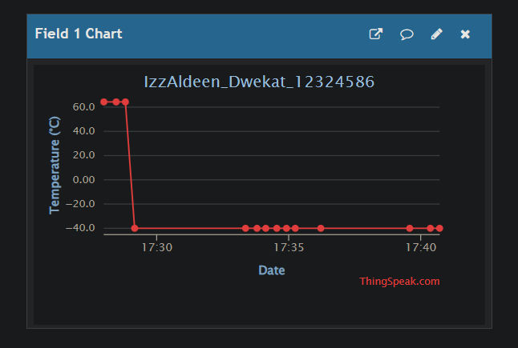

# This is an IoT lab

## NAME: Izz-Aldeen Riyad Dwekat
### UNI ID: 12324586

# LAB DESCRIPTION
This Lab aims to Collect Tempreture and humidity data, using WOKWI For simulating and THINGSPEAK for visualization cloud

# WOKWI
https://wokwi.com/projects/478868053968890881

# THINGSPEAK
https://thingspeak.mathworks.com/channels/3549707
#

[Source Code](sketch.ino)
##

[Diagram](diagram.json)

